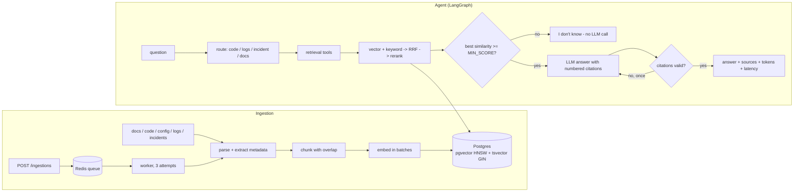

# DevMind - Incident Intelligence Platform

DevMind answers engineering questions ("why did payment-service fail after v2.14.0?",
"where is OAuth redirect validation implemented?") from a team's documentation, source
code, configuration, logs and incident reports, with citations to the exact sources.

**Stack:** Python, FastAPI, LangGraph, PostgreSQL + pgvector, Redis, OpenAI API (production)
/ Ollama (local), fastembed, React, Docker Compose.



## Retrieval results

Measured on the curated evaluation set (`backend/data/evaluation/v1.jsonl`: 60 questions,
54 answerable + 6 unanswerable) over a **1,050-document corpus (1,196 chunks)**, top-k = 5,
local `bge-small-en-v1.5` embeddings. Reproduce with `python scripts/evaluate.py --retrieval-only`.

| Retriever | Recall@5 | Hit@5 | MRR | p50 latency |
| --- | --- | --- | --- | --- |
| Vector only (pgvector) | 0.920 | 0.963 | 0.907 | 14 ms |
| Keyword only (Postgres FTS) | 0.691 | 0.759 | 0.688 | 15 ms |
| **Hybrid: RRF + rerank** | **0.960** | **1.000** | **0.963** | 40 ms |

Hybrid wins because the two retrievers fail differently. Vector search handles
paraphrase ("resilience settings" -> `retries.yaml`). Keyword search handles exact
identifiers (`req-7f3a91`, `DB_POOL_SIZE`, `INC-2026-1187`). Recall by question type
(hybrid): code 1.00, config 1.00, docs 0.97, incidents 0.93, logs 0.89.

### Full agent (answers, citations, refusals)

The same 60 questions run end to end through the LangGraph agent with a local **llama3.2 (3B)**
model in Ollama. Reproduce with `python scripts/evaluate.py`; the per-question report is in
`backend/data/evaluation/agent-report.json`.

| Metric | Result |
| --- | --- |
| Retrieval recall@5 / hit@5 (agent) | 0.960 / 1.000 |
| Answer correctness | 0.926 (50 / 54) |
| Citation accuracy | 0.926 (valid citations 0.963) |
| Unanswerable questions correctly refused | 6 / 6 (4 by the guardrail with no LLM call) |
| Answerable questions wrongly refused | 0 / 54 |
| Latency p50 / p95 | 1.2 s / 2.2 s |
| Tokens per question | ~1,220 prompt + ~36 completion |

The 4 wrong answers are model errors, not retrieval misses: the right source was retrieved,
but the 3B model quoted the wrong log line or left out part of the answer. A larger model
(e.g. `gpt-4o-mini` in production) is the expected fix.

**What the evaluation caught.** The first agent run reached recall@5 0.93. That is *below*
the plain retriever (0.96), because fusing the routed tool's ranking with the general search
gave double credit to overlapping hits. It filled the top 5 with incident reports for
"where is incident severity normalized?". The agent now keeps the general ranking and uses
the routed tool only to guarantee its source type is present. The run also showed the model
sometimes answering with only `[1]`; the citation validator now treats that as invalid and
retries.

## How the LLM is called

`app/llm.py` is the only module that talks to a model:

- **One client for local and production.** Ollama exposes the same API as OpenAI, so a
  single `OpenAI(base_url, api_key)` client serves both. Local development points
  `LLM_BASE_URL` at Ollama (`llama3.2`); production points it at `https://api.openai.com/v1`
  (`gpt-4o-mini`). No code changes between the two.
- **Cached client.** The client owns an HTTP connection pool, so it is created once
  (`lru_cache`) instead of paying a TCP + TLS handshake on every request.
- **Cost controls.** `temperature=0`, `max_completion_tokens` caps each answer, and a
  `finish_reason == "length"` truncation is logged. Token usage comes from the API response,
  not an estimate.
- **The LLM is only called when it's needed.** If the best cosine similarity from retrieval is
  below `MIN_SCORE`, the agent answers "I don't know" without calling the model at all.
  The threshold is calibrated on the eval set: off-topic questions top out at 0.54, and
  answerable ones start at 0.66, so it is 0.60.
- The sync SDK call runs in `asyncio.to_thread`, so it does not block the event loop. Provider
  errors (after the SDK's own retries) are returned as HTTP 503.

## Agentic RAG (LangGraph)

`app/agent/graph.py` runs these steps:

1. **route_question** - a rule-based router picks `code`, `logs`, `incident` or `docs`.
   It's deterministic and free; an LLM router would add a model call to every question.
2. **retrieve** - calls the route's tools concurrently: `search_code` (code + config only),
   `search_logs`, `search_incidents`, plus the general `search_knowledge_base`. It fuses their
   rankings with RRF.
3. **guardrail** - refuses without an LLM call when retrieval is weak (above).
4. **generate** - sources are numbered `[1]..[k]` in the prompt and the model must cite them.
   The question is wrapped in `<question>` tags and the rules are repeated after it, so injected
   instructions arrive as data.
5. **validate_citations** - every `[n]` must refer to a retrieved source, and there must be at
   least one. If not, the model gets **one** correction retry showing its bad answer. If the model
   honestly says "I don't know", that counts as a refusal, not a citation failure.

## Retrieval pipeline

`app/retrieval/hybrid.py`:

- **Vector:** `embedding <=> query` (cosine) on an HNSW index, top 20.
- **Keyword:** a generated, GIN-indexed `tsvector` over chunk text **plus the file path**
  (`config/retries.yaml` -> `config retries yaml`), so "which YAML file..." matches file names.
  Query terms are OR-ed: `plainto_tsquery` ANDs every word, so full questions would almost
  never match.
- **Fusion:** Reciprocal Rank Fusion, `score = sum 1/(60 + rank)`. It uses rank positions only,
  so cosine and `ts_rank` scores never need to be put on one scale.
- **Rerank:** the fused candidates are rescored as 0.5 x normalized RRF + 0.5 x query-term
  coverage of the chunk. That promotes chunks that answer the *whole* question.

## Ingestion

`app/ingestion/`: parse (Markdown, text, HTML, PDF, logs, code, YAML/JSON) -> classify the
source type from its path -> extract metadata (title, service, incident ID, severity, git
commit) -> chunk at ~1,000 characters with 150 of overlap, breaking on line boundaries -> embed in
batches of 64 (one model call per batch) -> store. The path and title are prepended to each
chunk before embedding, so a chunk from the middle of a file still carries its context. Content
hashes make re-ingestion idempotent.

Entry points: `POST /documents` (sync), `POST /ingestions` (Redis queue + worker, 3 attempts),
`POST /repositories/index` and `scripts/ingest.py` (a whole directory or repository).

## Evaluation methodology

`app/evaluation/` (metric definitions are pure functions in `metrics.py`):

| Metric | Definition |
| --- | --- |
| Recall@k | share of a question's expected sources found in the top-k |
| Hit@k / MRR | any expected source in the top-k / 1 / rank of the first one |
| Answer correctness | every key fact is stated: >= 75% of the fact's terms appear in the answer (tolerates rephrasing, still requires the numbers and names); for unanswerable questions, correct = refused |
| Citation accuracy | citations are valid and at least one cites an expected source |
| Citation precision | share of the cited sources that are expected sources |
| Refusal rates | false refusals on answerable questions, correct refusals on unanswerable ones |
| Latency, tokens | end-to-end p50/p95; prompt + completion tokens from the API |

**Corpus.** `data/corpus/` holds 24 hand-written gold sources: 7 incident reports, a
postmortem, runbooks, docs, TypeScript/Python code, YAML configs, logs and release notes.
`scripts/generate_corpus.py` adds about 1,000 seeded *distractor* documents (routine logs,
deploy records, ADRs, minor incidents and handlers across 15 services). They share
vocabulary with the questions but never contain the answers, so ranking has to be good.

## Run it

```bash
ollama pull llama3.2              # local LLM (https://ollama.com)
cp .env.example .env              # inside Docker use LLM_BASE_URL=http://host.docker.internal:11434/v1
docker compose up --build         # postgres, redis, api :8000, worker, frontend :5173

# index the 1,050-document evaluation corpus and run the benchmarks
docker compose exec api python scripts/generate_corpus.py /tmp/corpus
docker compose exec api python scripts/ingest.py /tmp/corpus
docker compose exec api python scripts/evaluate.py --retrieval-only
docker compose exec api python scripts/evaluate.py            # needs a configured LLM
```

Without Docker: `cd backend && uv sync --extra dev`, start Postgres (pgvector) and Redis,
then `uv run uvicorn app.main:app --reload` and `uv run python -m app.worker`.
Tests: `uv run pytest` (no database, model download or API key needed) and `uv run ruff check .`.

API docs: <http://localhost:8000/docs>. Main endpoints: `POST /chat`, `POST /search`,
`POST /incidents/analyze`, `POST /ingestions`, `POST /repositories/index`, `POST /evaluations/run`.

## Configuration

| Variable | Default | Notes |
| --- | --- | --- |
| `LLM_BASE_URL` | `http://localhost:11434/v1` (Ollama) | production: `https://api.openai.com/v1` |
| `LLM_API_KEY` | `ollama` | production: your OpenAI key |
| `LLM_MODEL` | `llama3.2` | production: `gpt-4o-mini` |
| `EMBEDDING_PROVIDER` | `local` | `local` = fastembed bge-small (CPU, free), or `openai` |
| `OPENAI_EMBEDDING_MODEL` | `text-embedding-3-small` | called with `dimensions=EMBEDDING_DIMENSION` |
| `EMBEDDING_DIMENSION` | `384` | size of the pgvector column; changing it needs a re-index |
| `MIN_SCORE` | `0.60` | guardrail; re-calibrate per embedding model |
| `MAX_COMPLETION_TOKENS` | `600` | per-answer cap |

## Limitations and next steps

- The router is rule-based. An LLM or classifier router would handle ambiguous questions
  better, at the cost of a model call.
- The reranker is lexical. A cross-encoder (e.g. `bge-reranker`) would rerank on meaning,
  at roughly 50-100 ms per query on CPU.
- Answer correctness is measured by key-fact term overlap. LLM-as-judge would score
  free-form answers better, but adds cost and its own variance.
- The eval set is small (60 questions) and curated by hand, so treat the numbers as a
  regression benchmark for this corpus, not a general claim.
